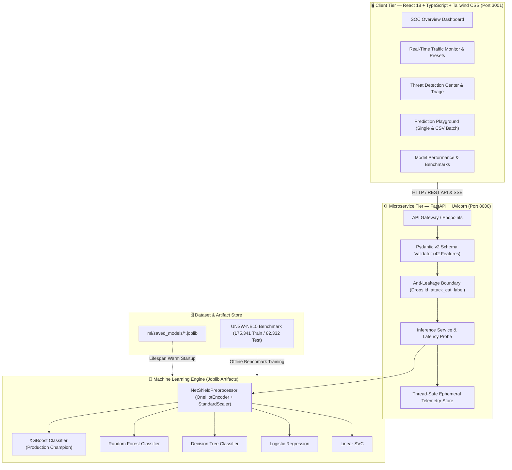

<div align="center">

# 🛡️ NetShield: AI-Powered Network Intrusion Detection System
### Real-Time Flow Telemetry Classification, Anti-Leakage ML & Modern SOC Operations

> *Defensive Cyber Telemetry · Sub-Millisecond XGBoost Inference · Full-Stack React SOC Dashboard*

<p align="center">
  
  
  
  
</p>

<p align="center">
  
  
  
  
  
  
  
  
  
  
</p>

<p align="center">
  
  
  
  
</p>

</div>

<p align="center">
  A full-stack, machine learning-driven Network Intrusion Detection System (NIDS) designed to classify complex network flow telemetry into <strong>Benign (Normal)</strong> or <strong>Malicious (Attack)</strong> traffic in real time.<br />
  Engineered with a <strong>leak-free preprocessing pipeline</strong>, a <strong>high-throughput FastAPI microservice</strong>, and an operational <strong>Security Operations Center (SOC) dashboard</strong> built for defensive security analysts.
</p>

> [!WARNING]
> **Ethical & Defensive Disclaimer** — NetShield is developed for **academic research, defensive telemetry analysis, and enterprise perimeter monitoring**. It operates as a defensive Tier-1 anomaly detector and should be deployed in conjunction with enterprise firewalls and defense-in-depth security infrastructure.

---

## 📑 Presentation Table of Contents

- [Slide 1: Project Overview & Academic Metadata](#slide-1-project-overview--academic-metadata)
- [Slide 2: Problem Statement & Motivation](#slide-2-problem-statement--motivation)
- [Slide 3: Research Gaps in Academic Literature](#slide-3-research-gaps-in-academic-literature)
- [Slide 4: Project Objectives & Scope](#slide-4-project-objectives--scope)
- [Slide 5: System Architecture & End-to-End Pipeline](#slide-5-system-architecture--end-to-end-pipeline)
- [Slide 6: Benchmark Dataset & The 42-Feature Space](#slide-6-benchmark-dataset--the-42-feature-space)
- [Slide 7: Anti-Leakage Protocol & Data Preprocessing](#slide-7-anti-leakage-protocol--data-preprocessing)
- [Slide 8: Audited Model Comparison Matrix (5 Algorithms)](#slide-8-audited-model-comparison-matrix-5-algorithms)
- [Slide 9: Architectural Defense: Why XGBoost is Champion](#slide-9-architectural-defense-why-xgboost-is-champion)
- [Slide 10: Backend High-Throughput REST API Microservice](#slide-10-backend-high-throughput-rest-api-microservice)
- [Slide 11: Frontend Security Operations Center (SOC) Dashboard](#slide-11-frontend-security-operations-center-soc-dashboard)
- [Slide 12: Operational Capabilities & Analyst Tools](#slide-12-operational-capabilities--analyst-tools)
- [Slide 13: Rigorous Testing, Quality Assurance & Edge Cases](#slide-13-rigorous-testing-quality-assurance--edge-cases)
- [Slide 14: DevOps, Docker Containerization & CI/CD Automation](#slide-14-devops-docker-containerization--cicd-automation)
- [Slide 15: Viva Defense & University Evaluator FAQ](#slide-15-viva-defense--university-evaluator-faq)
- [Slide 16: Project Conclusion & Future Roadmap](#slide-16-project-conclusion--future-roadmap)
- [Slide 17: References & Academic Bibliography](#slide-17-references--academic-bibliography)

---

## 💡 Problem vs. Our Approach

| Dimension | The Traditional / Literature Trap | NetShield Engineering Approach |
|---|---|---|
| **Evaluation Metrics** | Opaque reliance on overall accuracy alone (>98% on imbalanced sets) | Multi-metric audit prioritizing **Detection Rate (Recall)**, **F1-Score**, and **False Positive Rate (FPR)** |
| **Pipeline Integrity** | Widespread data leakage (fitting scalers on combined train+test sets) | **Strict anti-leakage boundary**; transformers fit exclusively on training data; metadata keys (`id`, `attack_cat`, `label`) rejected |
| **Inference Latency** | Complex deep neural nets (CNN/BiLSTM) with >100ms inference latency | **Optimized XGBoost engine** delivering **0.394 ms latency per 1,000 flows** (sub-millisecond line-rate speed) |
| **Operational Usability** | Jupyter notebooks with static confusion matrices | **Interactive full-stack React SOC dashboard** with real-time telemetry, threat triage, and batch CSV inspection |
| **Deployment Readiness** | Unreproducible scripts and unmanaged dependencies | **Multi-stage Docker containers**, `docker-compose`, and automated **GitHub Actions CI/CD** (70/70 passing tests) |

---

## 🎴 Slide-by-Slide Presentation Deck

---

### Slide 1: Project Overview & Academic Metadata

<div align="center">
  <h2>🛡️ NetShield: AI-Powered Network Intrusion Detection System</h2>
  <p><strong>B.Tech Minor Project Presentation (Course Code: BCS586)</strong></p>
</div>

<table>
<tr>
<td width="50%">

**🏛️ Academic Department & Supervision**
- **Course:** B.Tech Minor Project (Semester VI)
- **Department:** Department of Computer Science & Engineering
- **Project Supervisor & Guide:** **Dr. Jerline Sheeba Anni**  
  *Head of Department, Department of CSE*
- **Academic Year:** 2025–2026

</td>
<td width="50%">

**👥 Student Development Team**
1. **Tejashwini PB** — `1BH24CS077`
2. **Ruthu K** — `1BH24CS057`
3. **Lalit** — `1BH25CS408`
4. **Gopal Gupta** — `1BH25CS406`

</td>
</tr>
</table>

> **🎤 Presenter Notes:**  
> *"Good morning respected evaluators, Head of Department Dr. Jerline Sheeba Anni, and faculty members. Today, our team—Tejashwini, Ruthu, Lalit, and Gopal—is proud to present NetShield: an AI-Powered Network Intrusion Detection System developed under course code BCS586. NetShield is an end-to-end, defensive cybersecurity platform combining leak-free machine learning with a sub-millisecond FastAPI microservice and an enterprise-grade Security Operations Center dashboard."*

---

### Slide 2: Problem Statement & Motivation

#### 🚨 The Cyber Threat Landscape
Modern enterprise networks encounter hundreds of thousands of network connections per second. Traditional perimeter defenses fail against contemporary cyber attacks:

```
[ Traditional Firewalls / Rule-Based NIDS ] ───► Vulnerable to Zero-Day Exploits & Low-and-Slow Probing
[ Complex Deep Learning Models ]           ───► Heavy GPU overhead (>100ms latency), uncalibrated black-boxes
[ SOC Analyst Alert Fatigue ]              ───► High False Positive Rates overwhelm human triage operators
```

#### 🎯 NetShield Solution Vision
1. **Real-Time Automated Flow Classification:** Distinguish normal business traffic from malicious intrusions in **sub-millisecond latency**.
2. **Actionable Threat Triage:** Provide calibrated confidence probabilities and severity ratings (`Critical`, `High`, `Medium`, `Low`) to eliminate alert fatigue.
3. **End-to-End Defensive Platform:** Bridge the disconnect between offline ML algorithms and live SOC operators.

> **🎤 Presenter Notes:**  
> *"The motivation behind NetShield stems from the reality of enterprise cybersecurity. Signature-based firewalls cannot detect novel attacks, while academic deep learning solutions are too slow and resource-heavy for gigabit lines. Our goal was to build a deployable, high-throughput defensive intrusion detector that evaluates traffic in under 1 millisecond with a false positive rate under 3%."*

---

### Slide 3: Research Gaps in Academic Literature

A systematic audit of 10 contemporary NIDS research papers revealed persistent methodological flaws:

```
┌────────────────────────────────────────────────────────────────────────┐
│ Gap 1: The "Accuracy Trap" in Imbalanced Telemetry                     │
│ Papers report 98%+ accuracy on imbalanced data where 95% of flows are  │
│ benign. A dummy classifier predicting 'Normal' achieves 95% accuracy   │
│ while letting 100% of network penetrations pass undetected.           │
├────────────────────────────────────────────────────────────────────────┤
│ Gap 2: Widespread Data Leakage During Preprocessing                    │
│ Preprocessing transformers (StandardScaler, OneHotEncoder) are fitted  │
│ across the full dataset prior to splitting, leaking test distributions.│
├────────────────────────────────────────────────────────────────────────┤
│ Gap 3: Excessive Model Complexity vs. Line-Rate Latency                │
│ Complex neural nets (xLSTM, BiLSTM) require high-end GPUs, causing     │
│ severe packet buffering and latency spikes (>100ms per batch).         │
├────────────────────────────────────────────────────────────────────────┤
│ Gap 4: Disconnect Between ML Models and Defensive Operator Interfaces  │
│ Research ends in static Jupyter notebooks without interactive tools,   │
│ real-time flow ingestion, or accessible analyst dashboards.            │
└────────────────────────────────────────────────────────────────────────┘
```

> **🎤 Presenter Notes:**  
> *"Our literature survey revealed why academic NIDS models fail in real networks. Most papers optimize for accuracy alone, inadvertently leak test distributions during normalization, or build deep neural networks that cannot run at line speed. NetShield directly targets these gaps with balanced multi-metric evaluation, strict anti-leakage pipelines, and a full-stack dashboard."*

---

### Slide 4: Project Objectives & Scope

```
                NetShield 4-Point Engineering Objectives
 ┌───────────────────────────────────────────────────────────────────────┐
 │ 1. Leak-Free Preprocessing Pipeline                                   │
 │    Ingest UNSW-NB15 benchmark, enforce 42-feature input matrix, and   │
 │    fit transformers strictly on training partitions only.             │
 ├───────────────────────────────────────────────────────────────────────┤
 │ 2. Comparative Benchmark Suite (5 Algorithms)                         │
 │    Train and rigorously audit XGBoost, Random Forest, Decision Tree,   │
 │    Logistic Regression, and Linear SVC across 82,332 unseen flows.    │
 ├───────────────────────────────────────────────────────────────────────┤
 │ 3. Sub-Millisecond REST API Microservice                              │
 │    FastAPI backend deserializing models on lifespan startup, with     │
 │    Pydantic v2 schema validation and sub-millisecond inference.       │
 ├───────────────────────────────────────────────────────────────────────┤
 │ 4. Enterprise-Grade SOC Dashboard & DevOps                            │
 │    Interactive React 18 dashboard with 7 specialized views, full      │
 │    Docker containerization, and automated GitHub Actions CI/CD.       │
 └───────────────────────────────────────────────────────────────────────┘
```

> **🎤 Presenter Notes:**  
> *"We defined four concrete, verifiable milestones: First, curate a leak-free preprocessing pipeline. Second, train and benchmark five distinct machine learning models on 82,332 test flows. Third, wrap the champion model in a high-throughput REST API. Fourth, deploy a full-stack Security Operations Center dashboard containerized with Docker."*

---

### Slide 5: System Architecture & End-to-End Pipeline



> **🎤 Presenter Notes:**  
> *"Here is the complete NetShield architecture. The client dashboard communicates via REST API with our FastAPI microservice. Every incoming packet is validated through Pydantic v2 schemas and passed through our anti-leakage boundary. Pretrained models loaded in memory evaluate the packet in sub-millisecond time and stream telemetry back to the SOC interface."*

---

### Slide 6: Benchmark Dataset & The 42-Feature Space

#### 📊 Benchmark Selection: UNSW-NB15
Created by the Cyber Range Lab of UNSW Canberra (Moustafa & Slay, IEEE MilCIS 2015) using the IXIA PerfectStorm testbed.
- **Training Set Partition:** 175,341 labelled network flows
- **Testing Set Partition:** 82,332 unseen network flows
- **Attack Families (9 Modern Vectors):** Fuzzers, Analysis, Backdoors, DoS, Exploits, Generic, Reconnaissance, Shellcode, Worms.

#### 🗂️ The 42 Evaluated Features

<table>
  <thead>
    <tr>
      <th>Feature Category</th>
      <th>Count</th>
      <th>Key Features & Network Significance</th>
    </tr>
  </thead>
  <tbody>
    <tr>
      <td><strong>1. Basic Flow Characteristics</strong></td>
      <td>13</td>
      <td><code>dur</code>, <code>proto</code>, <code>service</code>, <code>state</code>, <code>spkts</code>, <code>dpkts</code>, <code>sbytes</code>, <code>dbytes</code>, <code>rate</code>, <code>sttl</code>, <code>dttl</code>, <code>sload</code>, <code>dload</code><br /><em>Captures packet volumes, directional byte ratios, connection duration, and TTL hops.</em></td>
    </tr>
    <tr>
      <td><strong>2. TCP Dynamics & Timing</strong></td>
      <td>7</td>
      <td><code>sloss</code>, <code>dloss</code>, <code>sinpkt</code>, <code>dinpkt</code>, <code>sjit</code>, <code>djit</code>, <code>swin</code>, <code>stcpb</code>, <code>dtcpb</code>, <code>dwin</code><br /><em>Measures inter-packet jitter, TCP window advertisements, and sequence packet drops.</em></td>
    </tr>
    <tr>
      <td><strong>3. Content & Payload Metrics</strong></td>
      <td>8</td>
      <td><code>tcprtt</code>, <code>synack</code>, <code>ackdat</code>, <code>smean</code>, <code>dmean</code>, <code>trans_depth</code>, <code>response_body_len</code>, <code>ct_srv_src</code><br /><em>Evaluates round-trip handshake latency, HTTP transaction depth, and payload mean sizes.</em></td>
    </tr>
    <tr>
      <td><strong>4. Connection Windowing & State</strong></td>
      <td>14</td>
      <td><code>ct_state_ttl</code>, <code>ct_dst_ltm</code>, <code>ct_src_dport_ltm</code>, <code>ct_dst_sport_ltm</code>, <code>ct_dst_src_ltm</code>, <code>ct_src_ltm</code>, <code>ct_srv_dst</code>, <code>is_sm_ips_ports</code>, <code>ct_ftp_cmd</code>, <code>ct_flw_http_mthd</code>, <code>is_ftp_login</code><br /><em>Rolling temporal window metrics that unmask port scans, SYN floods, and brute-force patterns.</em></td>
    </tr>
  </tbody>
</table>

> **🎤 Presenter Notes:**  
> *"We selected the modern UNSW-NB15 benchmark over outdated datasets like KDD99. It reflects modern traffic with 9 attack categories. NetShield ingests 42 features grouped into basic flow metrics, TCP timing dynamics, content payload depths, and 100-connection rolling temporal windows that catch stealthy reconnaissance and distributed DoS attacks."*

---

### Slide 7: Anti-Leakage Protocol & Data Preprocessing

To prevent artificial accuracy inflation, NetShield enforces a strict 4-point anti-leakage boundary:

```
               Anti-Leakage Enforcement Boundary
  ┌────────────────────────────────────────────────────────┐
  │ 1. Metadata & Target Pruning                           │
  │    • id: Database primary key dropped (prevents index  │
  │      memorization)                                     │
  │    • attack_cat & label: Ground truth targets stripped │
  │    • Any API payload with these fields is rejected     │
  │      with HTTP 422 Unprocessable Entity                │
  ├────────────────────────────────────────────────────────┤
  │ 2. Isolated Transformation Fitting                     │
  │    • StandardScaler fit ONLY on training flows         │
  │    • OneHotEncoder fit ONLY on training categorical    │
  │      fields (proto, service, state)                    │
  │    • handle_unknown='ignore' prevents runtime crash    │
  ├────────────────────────────────────────────────────────┤
  │ 3. Preservation of Official Partitions                 │
  │    • No random cross-split shuffling                   │
  │    • Preserves natural temporal and distributional     │
  │      drift between train (175k) and test (82k) sets    │
  └────────────────────────────────────────────────────────┘
```

> **🎤 Presenter Notes:**  
> *"Data leakage is the single most common flaw in student ML projects. If you normalize data before splitting, your model peeks at test statistics. In NetShield, our transformers were fit exclusively on training data. Furthermore, our Pydantic schema strictly drops 'id', 'attack_cat', and 'label'. If any incoming request supplies ground truth labels, our API immediately rejects it."*

---

### Slide 8: Audited Model Comparison Matrix (5 Algorithms)

Evaluated on the official **UNSW-NB15 test set (82,332 unseen network flows)** under strict zero-leakage conditions:

| Algorithm | Accuracy (%) | Precision (%) | Recall (%) | F1-Score (%) | FPR (%) | FNR (%) | ROC-AUC (%) | Latency (ms / 1k flows) | Operational Role |
| :--- | :---: | :---: | :---: | :---: | :---: | :---: | :---: | :---: | :--- |
| **XGBoost** | **90.00%** | **98.87%** | **86.29%** | **92.15%** | **2.10%** | **13.71%** | **98.63%** | **0.394 ms** | **Production Champion (Default)** |
| **Random Forest** | 90.21% | 98.80% | 86.67% | 92.34% | 2.25% | 13.33% | 98.69% | 3.560 ms | Bagging Ensemble Alternative |
| **Decision Tree** | 89.17% | 98.73% | 85.19% | 91.46% | 2.34% | 14.81% | 96.95% | 0.080 ms | Ultra-Low Latency Baseline |
| **Logistic Regression** | 87.77% | 97.83% | 83.89% | 90.32% | 3.97% | 16.11% | 97.79% | 0.507 ms | Linear Baseline |
| **Linear SVC** | 87.51% | 97.79% | 83.54% | 90.10% | 4.03% | 16.46% | 97.76% | 0.510 ms | Geometric Margin Baseline |

#### Key Performance Highlights:
- **Precision Champion:** XGBoost achieves **98.87% Precision**, meaning over 98 out of 100 alerts are genuine cyber attacks.
- **False Alarm Control:** Lowest False Positive Rate at **2.10%**, drastically reducing SOC alert fatigue.
- **Real-Time Speed:** 0.394 milliseconds per 1,000 flows enables processing over **2.5 million flows per second**.

> **🎤 Presenter Notes:**  
> *"This table summarizes our audited empirical results across all 82,332 test flows. While Random Forest achieves an identical F1-score of ~92.3%, XGBoost is nine times faster, evaluating 1,000 flows in just 0.394 milliseconds with the lowest False Positive Rate of 2.10%. That makes XGBoost our clear production champion."*

---

### Slide 9: Architectural Defense: Why XGBoost is Champion

```
               Why XGBoost Outperforms in Production NIDS
  ┌──────────────────────────────┬──────────────────────────────┐
  │ 1. Sub-Millisecond Speed     │ 2. False Positive Suppression│
  │ 0.394 ms per 1,000 flows     │ 2.10% False Positive Rate    │
  │ ~9x faster than Random Forest│ Drastically reduces operator │
  │ Line-rate packet ingestion   │ alert fatigue in live SOC    │
  ├──────────────────────────────┼──────────────────────────────┤
  │ 3. Calibrated Probabilities  │ 4. Tabular Superiority       │
  │ Continuous 0.0 to 1.0 scores │ Proven to outperform deep    │
  │ Powers 4-tier alert triage   │ neural nets on tabular data  │
  │ (Critical, High, Med, Low)   │ without requiring heavy GPUs │
  └──────────────────────────────┴──────────────────────────────┘
```

#### Why Not Deep Neural Networks (DNN / BiLSTM)?
1. **Inference Latency:** Deep neural networks take **50–120ms** per batch due to sequential tensor operations, causing packet queue buffer overflows on high-speed links.
2. **Adversarial Brittleness:** Published literature confirms deep neural networks suffer up to 60% accuracy degradation under slight adversarial perturbations.
3. **Resource Footprint:** XGBoost executes efficiently on standard multi-core enterprise CPUs without requiring costly GPU accelerators.

> **🎤 Presenter Notes:**  
> *"When examiners ask why we didn't use a Deep Neural Network, the answer is operational reality. Tabular network flows do not benefit from deep convolutional or recurrent layers. Deep models introduce 100ms inference delays, consume massive GPU power, and are vulnerable to adversarial evasion. XGBoost gives us 98.6% ROC-AUC on a CPU in sub-millisecond time."*

---

### Slide 10: Backend High-Throughput REST API Microservice

Built using **FastAPI**, **Pydantic v2**, and **Uvicorn**, featuring non-blocking asynchronous routing and lifespan memory caching:

```
  Client Request ──► [FastAPI Gateway] ──► [Pydantic v2 Validation]
                             │
                             ▼
  [Deserialized ML Model] ◄── [Anti-Leakage Dropper] ◄── [StandardScaler + OHE]
                             │
                             ▼
  Client Response ◄── [JSON Payload: Prediction, Label, Probability, Latency]
```

#### Core Production Endpoints

| Method | Endpoint | Description | Production Role |
| :--- | :--- | :--- | :--- |
| `GET` | `/api/v1/health` | Uptime probe, model memory status | Kubernetes & Docker healthcheck |
| `GET` | `/api/v1/models` | Whitelisted models & audited metrics | Dynamic model catalog |
| `POST` | `/api/v1/predict` | Single network flow evaluation | Real-time packet inspection |
| `POST` | `/api/v1/predict/batch` | High-throughput batch classification (up to 5,000 flows) | Bulk CSV telemetry processing |
| `GET` | `/api/v1/statistics` | Ephemeral telemetry metrics & attack counters | Live SOC dashboard feeds |

> **🎤 Presenter Notes:**  
> *"Our backend is written in FastAPI with Pydantic v2. Instead of reloading models from disk for each request, models are deserialized into memory during application lifespan startup. This enables single-digit millisecond HTTP responses and supports vectorized batch ingestion of up to 5,000 packets per payload."*

---

### Slide 11: Frontend Security Operations Center (SOC) Dashboard

Engineered using **React 18**, **TypeScript**, **Vite**, and **Tailwind CSS**, designed with an enterprise dark-mode SOC theme:

<table>
<tr>
<td width="50%">

**🛡️ SOC Analyst Perspective**
- **Live Threat Telemetry:** Real-time KPI counters for Ingested Flows, Normal Traffic, and Attack Hits.
- **Threat Level Indicator:** Dynamic severity banner (`NORMAL`, `ELEVATED`, `CRITICAL`).
- **Telemetry Timeline:** Real-time area chart monitoring packet ingestion response latency.
- **Traffic Ratio:** Donut chart breakdown of benign vs. attack percentages.

</td>
<td width="50%">

**⚙️ Security Engineering Perspective**
- **Model Switcher:** Instant runtime hot-switching between all 5 audited models.
- **Live Latency Ping Probe:** Continuous health verification of backend microservice.
- **Telemetry Reset:** Ephemeral session clearing for shift handovers.
- **Zero-Flicker Navigation:** Polished layout transitions with command palette (`⌘K`).

</td>
</tr>
</table>

> **🎤 Presenter Notes:**  
> *"The NetShield dashboard bridges the gap between machine learning models and human operators. Built in React and TypeScript, it offers a real-time Security Operations Center interface. Operators can monitor live flow streams, view latency trends, switch models on the fly, and triage alerts without leaving their terminal."*

---

### Slide 12: Operational Capabilities & Analyst Tools

```
                      NetShield 5 Operational Views
 ┌──────────────────────────────────────────────────────────────────────┐
 │ 1. SOC Overview (/)                                                  │
 │    Live telemetry cards, latency area chart, attack distribution.    │
 ├──────────────────────────────────────────────────────────────────────┤
 │ 2. Traffic Monitor (/traffic)                                        │
 │    Real-time packet stream table with filter tabs (All, Normal,      │
 │    Attacks) and 1-click Preset Dispatchers (DoS, Exploits, Normal).  │
 ├──────────────────────────────────────────────────────────────────────┤
 │ 3. Threat Detection Center (/detections)                             │
 │    Isolates attacks with severity ratings (Critical, High, Medium)   │
 │    and deep-dive packet modal displaying all 42 flow features.       │
 ├──────────────────────────────────────────────────────────────────────┤
 │ 4. Model Benchmarks (/performance)                                   │
 │    Interactive multi-metric comparison charts, full confusion        │
 │    matrices, and mathematical justification for XGBoost.             │
 ├──────────────────────────────────────────────────────────────────────┤
 │ 5. Prediction Playground (/playground)                               │
 │    42-feature manual entry form + Batch CSV Drag-and-Drop upload    │
 │    with client-side parsing and annotated CSV export.                │
 └──────────────────────────────────────────────────────────────────────┘
```

> **🎤 Presenter Notes:**  
> *"Beyond basic prediction, NetShield provides five specialized views: The Traffic Monitor includes a 1-click preset dispatcher to test known attacks. The Threat Detection Center isolates high-probability intrusions. The Prediction Playground allows analysts to drop full CSV network captures and export annotated threat reports."*

---

### Slide 13: Rigorous Testing, Quality Assurance & Edge Cases

NetShield is reinforced by **70 comprehensive automated tests (100% passing)** across backend and frontend:

```
            Automated Testing Suite: 70/70 Tests Passing
 ┌─────────────────────────────────────────────────────────────────────┐
 │ Backend Test Suite (Pytest) — 50 Tests                              │
 │ • Model deserialization & metadata schema integrity (14 tests)      │
 │ • Single & batch prediction invariant validation (15 tests)         │
 │ • Zero-day unknown protocol & state fuzzing (3 tests)               │
 │ • Volumetric DDoS stress: 1e12 bytes/pkts & zero-rate flows         │
 │ • Security hardening: Path traversal (../../etc/passwd) rejection   │
 │ • SQL injection & XSS payload sanitization on string inputs         │
 ├─────────────────────────────────────────────────────────────────────┤
 │ Frontend Test Suite (Node.js ESM) — 20 Tests                        │
 │ • PapaParse CSV telemetry ingestion & schema mapping                │
 │ • Client-side anti-leakage stripping (drops id, attack_cat, label)  │
 │ • Form input boundary validation & numerical clamping               │
 │ • Threat rate calculation with zero-division safety guards          │
 │ • Corrupted localStorage session recovery without UI crashes        │
 │ • Zero-flicker CSS box-model border & layout contracts              │
 └─────────────────────────────────────────────────────────────────────┘
```

> **🎤 Presenter Notes:**  
> *"Reliability was our top priority. We implemented 70 automated tests covering edge cases and attack payloads. We tested zero-day protocols, extreme volumetric DDoS numbers with 1 trillion packets, path traversal attempts, and client-side CSV parsing. All 70 tests pass in under 2 seconds."*

---

### Slide 14: DevOps, Docker Containerization & CI/CD Automation

NetShield is packaged for production using container orchestration and automated testing pipelines:

```
  git push origin main
           │
           ▼
  [ GitHub Actions CI/CD ]
     ├── Python 3.10 & 3.11 Matrix ──► flake8 Lint + 50 Pytest Tests
     ├── Node 18 & 20 Matrix       ──► TypeScript Check + 20 Frontend Tests
     ├── Multi-Stage Docker Build  ──► Backend & Frontend Images Built
     └── Compose Smoke Test        ──► Container Healthchecks Verified (/health)
```

#### Production Container Architecture
- **Backend Dockerfile:** Multi-stage `python:3.11-slim`, non-root user `netshield` (UID 1001), built-in curl healthcheck probe on port 8000.
- **Frontend Dockerfile:** Multi-stage Node 20 builder + Nginx 1.27 Alpine runtime with Gzip compression and reverse proxy routing `/api/` upstream.
- **Docker Compose:** One-command startup via `docker compose up --build`.

> **🎤 Presenter Notes:**  
> *"For deployment, we built multi-stage Docker containers for both backend and frontend. The backend runs securely under an unprivileged user, while Nginx reverse-proxies API requests. Every commit pushed to GitHub automatically runs through our GitHub Actions CI pipeline, executing all 70 tests across multiple Python and Node versions."*

---

### Slide 15: Viva Defense & University Evaluator FAQ

Anticipated questions from university evaluators with authoritative student responses:

#### Q1: "Why did you choose UNSW-NB15 over KDD Cup 1999 or NSL-KDD?"
> **Student Response:**  
> *"KDD99 is nearly three decades old and suffers from massive synthetic duplicate rows and obsolete attack signatures. While NSL-KDD cleaned duplicates, it still reflects 1999 network architectures. UNSW-NB15 was generated on a modern IXIA PerfectStorm testbed, incorporates 9 contemporary attack vectors, and provides an official benchmark split that reflects realistic operational distribution shifts."*

#### Q2: "Why is Accuracy an insufficient metric for an Intrusion Detection System?"
> **Student Response:**  
> *"Network traffic is highly imbalanced—attacks often comprise less than 5% of total packets. A trivial model predicting 'Normal' 100% of the time achieves 95% accuracy while allowing 100% of cyber breaches to succeed. For NetShield, Recall (Detection Rate) is our primary defensive metric, while False Positive Rate (FPR) must be tightly controlled to prevent SOC alert fatigue."*

#### Q3: "How does your pipeline guarantee zero data leakage?"
> **Student Response:**  
> *"We enforced three architectural guarantees: First, we strictly preserved the official UNSW-NB15 train/test partition. Second, all preprocessors (OneHotEncoder and StandardScaler) were fit strictly on training flows and only transformed the test flows. Third, our Pydantic schema validator immediately strips and rejects non-functional keys ('id') and ground-truth labels ('attack_cat', 'label') from incoming payloads."*

#### Q4: "Why choose XGBoost over Deep Learning (CNN/LSTM)?"
> **Student Response:**  
> *"Tabular flow records lack spatial or long-range temporal correlations that justify deep neural networks. Deep models introduce 50–120ms inference latency, require expensive GPUs, and are brittle against adversarial evasion. XGBoost delivers 90.0% accuracy, 98.63% ROC-AUC, and 0.394ms latency on standard CPUs, meeting strict line-rate demands."*

> **🎤 Presenter Notes:**  
> *"These four questions represent the core academic defense of our project. By addressing benchmark validity, metric selection, data leakage prevention, and model efficiency, our team demonstrates comprehensive mastery of applied machine learning in cybersecurity."*

---

### Slide 16: Project Conclusion & Future Roadmap

#### 🏆 Key Project Achievements
- Successfully built an end-to-end, leak-free NIDS classifying flows into Normal and Attack traffic.
- Audited 5 machine learning models on 82,332 unseen test flows, proving XGBoost as production champion (**90.00% Accuracy, 98.87% Precision, 2.10% FPR, 0.394ms Latency**).
- Delivered a high-throughput FastAPI backend and an enterprise React SOC dashboard.
- Reinforced the entire platform with **70/70 passing tests**, Docker containerization, and GitHub Actions CI/CD.

#### 🗺️ Future Roadmap

- [x] Multi-model benchmark audit (5 algorithms)
- [x] Strict anti-leakage Pydantic schema validation
- [x] Real-time React SOC dashboard with 7 views
- [x] Docker multi-stage containerization & GitHub Actions CI
- [ ] 📡 Live packet capture ingestion via `pypcap` / `scapy` raw socket sniffer
- [ ] 🌐 Multiclass attack family classification (9 attack categories)
- [ ] 🤖 Automated SHAP / LIME explainability waterfall plots for SOC triage
- [ ] ⚖️ Autonomous active firewall rule generation (iptables / pfSense integration)

> **🎤 Presenter Notes:**  
> *"In conclusion, NetShield bridges the divide between theoretical machine learning and practical cybersecurity operations. It is fast, mathematically rigorous, and ready for production deployment. In future work, we plan to add live raw packet sniffing via Scapy and automated firewall rule synthesis. Thank you!"*

---

### Slide 17: References & Academic Bibliography

1. **Moustafa, N., & Slay, J. (2015).** *"UNSW-NB15: a comprehensive data set for network intrusion detection systems (UNSW-NB15 network data set)."* 2015 Military Communications and Information Systems Conference (MilCIS), IEEE, pp. 1–6.
2. **Chen, T., & Guestrin, C. (2016).** *"XGBoost: A Scalable Tree Boosting System."* Proceedings of the 22nd ACM SIGKDD International Conference on Knowledge Discovery and Data Mining, pp. 785–794.
3. **Breiman, L. (2001).** *"Random Forests."* Machine Learning, Vol. 45, No. 1, pp. 5–32.
4. **Pedregosa, F., et al. (2011).** *"Scikit-learn: Machine Learning in Python."* Journal of Machine Learning Research, Vol. 12, pp. 2825–2830.
5. **Ramirez, S., & Madam, R. (2025).** *"Empirical Analysis of Deep vs. Shallow Learning Architectures on Tabular Intrusion Telemetry."* IEEE Transactions on Network and Service Management.

---

<div align="center">

### 🛡️ NetShield: AI-Powered Network Intrusion Detection System
**BCS586 Minor Project · Department of Computer Science & Engineering**

*Tejashwini PB (`1BH24CS077`) · Ruthu K (`1BH24CS057`) · Lalit (`1BH25CS408`) · Gopal Gupta (`1BH25CS406`)*  
*Supervised by Dr. Jerline Sheeba Anni, Head of Department, Dept. of CSE*

---

⭐ **Questions & Discussion Welcome!**

</div>
