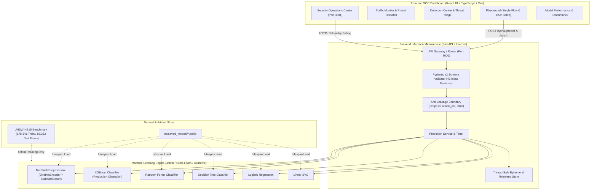
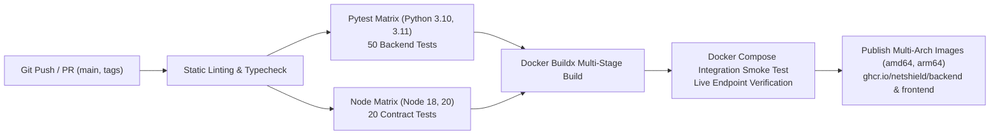

# 🛡️ NetShield: AI-Powered Network Intrusion Detection System

[](https://python.org)
[](https://fastapi.tiangolo.com)
[](https://react.dev)
[](https://www.typescriptlang.org)
[](https://vitejs.dev)
[](https://tailwindcss.com)
[](https://scikit-learn.org)
[](https://xgboost.readthedocs.io)
[](https://www.docker.com)
[](https://docs.docker.com/compose/)
[](https://nginx.org)
[](https://github.com)
[](https://github.com)

**NetShield** is a defensive, machine learning-driven Network Intrusion Detection System (NIDS) designed to classify complex network flow telemetry into **Benign (Normal)** or **Malicious (Attack)** traffic in real time. 

Engineered against the modern **UNSW-NB15** cybersecurity benchmark, NetShield integrates a rigorous anti-leakage ML pipeline, a high-throughput **FastAPI** inference microservice, and a modern Security Operations Center (**SOC**) dashboard built with **React**, **TypeScript**, and **Tailwind CSS**.

---

## 📑 Table of Contents

- [1. Academic Context & Credits](#1-academic-context--credits)
- [2. System Architecture](#2-system-architecture)
- [3. Machine Learning Models & Benchmark Audit](#3-machine-learning-models--benchmark-audit)
- [4. Anti-Leakage Protocol & Feature Space](#4-anti-leakage-protocol--feature-space)
- [5. Backend REST API](#5-backend-rest-api)
- [6. Frontend SOC Dashboard](#6-frontend-soc-dashboard)
- [7. Repository Structure](#7-repository-structure)
- [8. Installation & Quick Start](#8-installation--quick-start)
- [9. Testing & Verification](#9-testing--verification)
- [10. CI/CD Pipeline & DevOps Automation](#10-cicd-pipeline--devops-automation)
- [11. References & Bibliography](#11-references--bibliography)
- [12. License & Ethical Disclaimer](#12-license--ethical-disclaimer)

---

## 1. Academic Context & Credits

- **Course:** B.Tech Minor Project (Course Code: `BCS586`, Semester VI)
- **Department:** Department of Computer Science & Engineering
- **Project Supervisor & Guide:** Dr. Jerline Sheeba Anni, Head of Department, Dept. of CSE
- **Student Development Team:**
  - **Tejashwini PB** (`1BH24CS077`)
  - **Ruthu K** (`1BH24CS057`)
  - **Lalit** (`1BH25CS408`)
  - **Gopal Gupta** (`1BH25CS406`)

---

## 2. System Architecture



---

## 3. Machine Learning Models & Benchmark Audit

NetShield trains and evaluates 5 distinct machine learning algorithms on the official **UNSW-NB15** partitioned test set (**82,332 unseen test flows**). Evaluation was audited under zero-leakage constraints.

### Audited Model Comparison Matrix

| Model | Accuracy (%) | Precision (%) | Recall (%) | F1-Score (%) | FPR (%) | FNR (%) | ROC-AUC (%) | Latency (ms / 1k flows) | Role / Status |
| :--- | :---: | :---: | :---: | :---: | :---: | :---: | :---: | :---: | :--- |
| **XGBoost** | **90.00%** | **98.87%** | **86.29%** | **92.15%** | **2.10%** | **13.71%** | **98.63%** | **0.394 ms** | **Production Champion (Default)** |
| **Random Forest** | 90.21% | 98.80% | 86.67% | 92.34% | 2.25% | 13.33% | 98.69% | 3.560 ms | Bagging Ensemble Alternative |
| **Decision Tree** | 89.17% | 98.73% | 85.19% | 91.46% | 2.34% | 14.81% | 96.95% | 0.080 ms | Ultra-Low Latency Baseline |
| **Logistic Regression** | 87.77% | 97.83% | 83.89% | 90.32% | 3.97% | 16.11% | 97.79% | 0.507 ms | Linear Baseline |
| **Linear SVC** | 87.51% | 97.79% | 83.54% | 90.10% | 4.03% | 16.46% | 97.76% | 0.510 ms | Geometric Margin Baseline |

### Why XGBoost was chosen as Production Default:
1. **Sub-Millisecond Latency:** XGBoost evaluates 1,000 flows in **0.394 ms** (~9x faster than Random Forest's 3.56 ms), critical for real-time packet stream ingestion.
2. **Lowest False Positive Rate (FPR):** At **2.10% FPR**, it produces the lowest rate of false alarms, minimizing SOC analyst alert fatigue.
3. **Calibrated Probabilities:** Yields reliable, well-calibrated confidence probabilities for high-confidence alert gating.

---

## 4. Anti-Leakage Protocol & Feature Space

To guarantee production generalization and avoid the catastrophic synthetic accuracy spikes common in naive NIDS implementations, NetShield enforces strict architectural anti-leakage rules:

1. **Exclusion of Metadata & Ground Truth:**
   - `id`: Non-functional database primary key (would cause index memorization).
   - `attack_cat`: Ground-truth multiclass target label.
   - `label`: Ground-truth binary target label (`0 = Normal`, `1 = Attack`).
   - *Any incoming prediction payload attempting to supply these keys is immediately rejected by the Pydantic schema validator with an HTTP 422 error.*
2. **Fit Exclusively on Training Data:**
   - Transformers (`OneHotEncoder` and `StandardScaler`) are fit **only** on the training set (`UNSW_NB15_training-set.csv`).
   - Categorical features use `handle_unknown='ignore'` to robustly digest unseen protocols or states at inference time.

### The 42 Evaluated Features

| Category | Count | Feature Names |
| :--- | :---: | :--- |
| **Basic Flow Characteristics** | 13 | `dur`, `proto`, `service`, `state`, `spkts`, `dpkts`, `sbytes`, `dbytes`, `rate`, `sttl`, `dttl`, `sload`, `dload` |
| **TCP Dynamics & Timing** | 7 | `sloss`, `dloss`, `sinpkt`, `dinpkt`, `sjit`, `djit`, `swin`, `stcpb`, `dtcpb`, `dwin` |
| **Content & Payload Metrics** | 8 | `tcprtt`, `synack`, `ackdat`, `smean`, `dmean`, `trans_depth`, `response_body_len`, `ct_srv_src` |
| **Connection Counts & Windowing** | 14 | `ct_state_ttl`, `ct_dst_ltm`, `ct_src_dport_ltm`, `ct_dst_sport_ltm`, `ct_dst_src_ltm`, `ct_src_ltm`, `ct_srv_dst`, `is_sm_ips_ports`, `ct_ftp_cmd`, `ct_flw_http_mthd`, `ct_src_ltm`, `is_ftp_login` |

---

## 5. Backend REST API

Built with **FastAPI**, **Pydantic v2**, and **Uvicorn**, the backend serves models deserialized once at application lifespan startup.

### Primary Endpoints

| Method | Endpoint | Description | Sample Response / Status |
| :--- | :--- | :--- | :--- |
| `GET` | `/api/v1/health` | Service health, uptime, loaded models & artifact status | `{"status": "healthy", "version": "1.0.0"}` |
| `GET` | `/api/v1/models` | Whitelisted models, metadata, audited accuracy & default model | Model catalog with Phase 2 audit metrics |
| `POST` | `/api/v1/predict` | Single network flow classification with fine-grained latency breakdown | `{"prediction": 1, "label": "Attack", "probability": 0.98}` |
| `POST` | `/api/v1/predict/batch` | High-throughput vectorized batch classification (up to 5,000 flows) | Itemized array of predictions + batch metrics |
| `GET` | `/api/v1/statistics` | Ephemeral telemetry counters (total flows, normal vs attack counts) | Ingested flow counters & model usage breakdown |
| `GET` | `/docs` | Interactive Swagger UI / OpenAPI documentation | Interactive API tester |

### Sample Single Flow Request (`POST /api/v1/predict?model_name=xgboost`)

```bash
curl -X POST "http://localhost:8000/api/v1/predict?model_name=xgboost" \
  -H "Content-Type: application/json" \
  -d '{
    "dur": 0.000011,
    "proto": "udp",
    "service": "-",
    "state": "INT",
    "spkts": 2,
    "dpkts": 0,
    "sbytes": 496,
    "dbytes": 0,
    "rate": 90909.0902,
    "sttl": 254,
    "dttl": 0,
    "sload": 180363632.0,
    "dload": 0.0,
    "sloss": 0,
    "dloss": 0,
    "sinpkt": 0.011,
    "dinpkt": 0.0,
    "sjit": 0.0,
    "djit": 0.0,
    "swin": 0,
    "stcpb": 0,
    "dtcpb": 0,
    "dwin": 0,
    "tcprtt": 0.0,
    "synack": 0.0,
    "ackdat": 0.0,
    "smean": 248,
    "dmean": 0,
    "trans_depth": 0,
    "response_body_len": 0,
    "ct_srv_src": 2,
    "ct_state_ttl": 2,
    "ct_dst_ltm": 1,
    "ct_src_dport_ltm": 1,
    "ct_dst_sport_ltm": 1,
    "ct_dst_src_ltm": 2,
    "is_ftp_login": 0,
    "ct_ftp_cmd": 0,
    "ct_flw_http_mthd": 0,
    "ct_src_ltm": 1,
    "ct_srv_dst": 2,
    "is_sm_ips_ports": 0
  }'
```

---

## 6. Frontend SOC Dashboard

Built with **React 18**, **TypeScript**, **Vite**, **Tailwind CSS**, and **Recharts**, the NetShield frontend functions as an operational Security Operations Center interface:

### Dashboard Capabilities & Views

1. **Security Operations Center Overview (`/`):**
   - Live telemetry KPI cards (Ingested flows, Normal traffic, Attack alerts, Active model).
   - Ingestion response time timeline (area chart across recent packets).
   - Traffic distribution ratio (donut chart with percentage breakdown).
   - Cumulative invocations breakdown per model.
   - Interactive empty states with one-click test packet dispatchers.
2. **Traffic Monitor (`/traffic`):**
   - Real-time flow stream table with filter tabs (*All*, *Normal*, *Attacks*).
   - Preset Dispatch Deck for one-click testing of verified UNSW-NB15 attack types (Backdoors, DoS, Exploits, Normal HTTP).
3. **Detection Center (`/detections`):**
   - Threat triage table isolating suspicious flows (Label 1).
   - Severity scoring (*Critical*, *High*, *Medium*, *Low*) determined by model probability.
   - Deep-dive packet modal displaying the entire 42-feature tuple.
4. **Model Performance & Benchmarks (`/performance`):**
   - Multi-metric benchmark charts comparing all 5 models.
   - Full confusion matrix statistics (TP, TN, FP, FN, FPR, FNR, ROC-AUC).
   - Formal architectural defense justifying the selection of XGBoost.
5. **Prediction Playground (`/playground`):**
   - **Interactive Form:** 42-feature manual entry across 4 organized tabs with real-time validation and preset loaders.
   - **Batch CSV Upload:** Client-side CSV parsing with PapaParse, automatic leakage exclusion (`id`, `attack_cat`, `label`), progress indicator, and annotated CSV download with predictions and probabilities appended.
6. **Academic Showcase & Citations (`/academic`):**
   - Full IEEE MilCIS 2015 bibliographic citations, project methodology, and department credits.
7. **System Settings (`/settings`):**
   - API endpoint configuration, live latency ping probe, global model switcher, and telemetry reset.

### Advanced SaaS Utilities
- **Command Palette (`⌘K` / `Ctrl+K`):** Fast keyboard-driven page navigation, quick model switching, and action dispatch.
- **Keyboard Shortcuts Cheatsheet (`?`):** Quick-reference modal for hotkeys (`1`–`7` for pages, `R` to refresh, `ESC` to close).
- **First-Run Onboarding Tour:** Interactive 4-step modal introducing core dashboard features to new operators.
- **Zero-Flicker Navigation:** Rock-solid sidebar transitions without layout jumps or box-shadow flash.

---

## 7. Repository Structure

```
NetSheild/
├── dataset/                           # Benchmark datasets
│   ├── UNSW_NB15_training-set.csv     # Official UNSW-NB15 training partition (175,341 rows)
│   ├── UNSW_NB15_testing-set.csv      # Official UNSW-NB15 testing partition (82,332 rows)
│   └── NUSW-NB15_features.csv         # Feature dictionary & data type mappings
├── ml/                                # Machine learning pipeline
│   ├── preprocessing.py               # Leak-free NetShieldPreprocessor transformer
│   ├── train.py                       # Training script for 5 candidate models
│   ├── evaluate.py                    # Evaluation & audit metrics generator
│   └── saved_models/                  # Serialized Joblib artifacts
│       ├── preprocessor.joblib        # Fitted OneHotEncoder + StandardScaler
│       ├── xgboost.joblib             # Production champion model
│       ├── random_forest.joblib       # Random forest classifier
│       ├── decision_tree.joblib       # Decision tree classifier
│       ├── logistic_regression.joblib # Logistic regression classifier
│       └── linear_svc.joblib          # Linear SVC classifier
├── backend/                           # FastAPI REST microservice
│   ├── app/
│   │   ├── main.py                    # App entrypoint, lifespan loader, CORS middleware
│   │   ├── config.py                  # Environment-aware settings
│   │   ├── schemas/                   # Pydantic v2 validation models
│   │   │   ├── prediction.py          # 42-feature input, single & batch response schemas
│   │   │   ├── health.py              # Health check response schema
│   │   │   ├── models.py              # Model discovery schemas
│   │   │   └── statistics.py          # Telemetry counters schema
│   │   ├── services/                  # Business logic
│   │   │   ├── model_service.py       # Artifact discovery & metadata lookup
│   │   │   └── prediction_service.py  # Inference orchestration & thread-safe metrics
│   │   └── api/routes/                # Route handlers (/predict, /health, /models, /statistics)
│   ├── tests/                         # Pytest test suite (24 tests)
│   └── requirements.txt               # Backend Python dependencies
├── frontend/                          # React + TypeScript + Vite dashboard
│   ├── src/
│   │   ├── pages/                     # 7 core views (Overview, Traffic, Detections, etc.)
│   │   ├── components/                # Layout, Charts, Playground, and Common UI
│   │   ├── context/AppContext.tsx     # Global state management & telemetry polling
│   │   ├── api/client.ts              # Type-safe Fetch API client
│   │   ├── types/                     # TypeScript interfaces for flows, models, and telemetry
│   │   └── tests/test_frontend.mjs    # Frontend contract & bundle test runner (10 tests)
│   ├── package.json                   # Frontend npm configuration & scripts
│   ├── tailwind.config.js             # Cybersecurity dark-theme color palette
│   └── vite.config.ts                 # Dual-stack IPv6/IPv4 dev server configuration
├── research/                          # Academic documentation & audit reports
│   ├── 01_PROJECT_FILE_INVENTORY.md   # Discovery audit across all workspace files
│   ├── 05_UNSW_NB15_DATASET_ANALYSIS.md # Feature distribution & protocol analysis
│   ├── 10_REFERENCES.md               # IEEE formatted bibliography
│   └── reports/                       # CSV audit metrics & phase benchmark reports
├── tests/                             # Root pipeline integration tests (5 tests)
│   ├── test_preprocessing.py          # Transformer serialization & anti-leakage checks
│   └── test_pipeline.py               # End-to-end model inference checks
└── README.md                          # Master project documentation (this file)
```

---

## 8. Installation & Quick Start

NetShield supports both **One-Click Docker Deployment** (recommended for production and evaluation) and **Manual Local Execution**.

### Prerequisites
- **For Docker:** Docker Engine 20.10+ and Docker Compose v2+
- **For Local Setup:** Python 3.9–3.11, Node.js 18+, and `npm`

---

### Option A: One-Click Docker Deployment (Recommended)

1. Clone the repository and navigate into the root directory:
   ```bash
   git clone https://github.com/your-username/NetShield.git
   cd NetShield
   ```

2. Build and launch all containerized services:
   ```bash
   docker compose up --build -d
   ```

3. Access the live services:
   - **Frontend SOC Dashboard:** [http://localhost:3001](http://localhost:3001)
   - **Backend API Docs (Swagger UI):** [http://localhost:8000/docs](http://localhost:8000/docs)
   - **Backend Health Check:** [http://localhost:8000/api/v1/health](http://localhost:8000/api/v1/health)

4. Stop the deployment:
   ```bash
   docker compose down
   ```

---

### Option B: Local Containerized Development (with Hot-Reload)

To develop with live file watching and code changes instantly synced into the containers:
```bash
docker compose -f docker-compose.dev.yml up
```

---

### Option C: Manual Local Setup (Without Docker)

#### 1. Backend Setup & Launch
1. Create and activate a Python virtual environment:
   ```bash
   python3 -m venv venv
   source venv/bin/activate       # On Windows: venv\Scripts\activate
   ```
2. Install dependencies:
   ```bash
   pip install -r backend/requirements.txt
   ```
3. Start the FastAPI ASGI server:
   ```bash
   python3 -m uvicorn backend.app.main:app --host 0.0.0.0 --port 8000 --reload
   ```

#### 2. Frontend Setup & Launch
1. Open a new terminal and navigate to `frontend/`:
   ```bash
   cd frontend
   npm install
   npm run dev
   ```
2. Access the dashboard at [http://localhost:3001](http://localhost:3001).

---

## 9. Testing & Verification

NetShield includes comprehensive, automated test suites across both backend and frontend layers (**70 total tests**, 100% passing):

### Run All Backend Tests (Pytest)
```bash
python3 -m pytest backend/tests/ tests/ -v
```
*Executes **50 test cases** across 8 test suites verifying:*
- **Defensive Edge Cases (`test_edge_cases.py`):**
  - Unseen zero-day protocols, encrypted meshes, and corrupt TCP states without server crashes.
  - Volumetric DDoS floods with astronomical byte/packet counts (`1e12` bytes, `1e9` rate) without numerical overflow or NaN.
  - Zero-value flows preventing division-by-zero errors.
  - Nanosecond floating-point precision metrics.
  - Path traversal injection (`../../../../etc/shadow`) with automated error sanitization.
  - SQL injection and XSS categorical payload isolation.
  - Vectorized batch invariants across all 5 candidate models.
- **Health & Routes (`test_health.py`):** Service availability and loaded models status.
- **Model Discovery (`test_models.py`):** Whitelisted catalog and benchmark accuracy metrics.
- **Single-Flow Prediction (`test_predict.py`):** XGBoost, Random Forest, Decision Tree, Logistic Regression, and Linear SVC inference.
- **Batch Processing (`test_batch_predict.py`):** Batch object and raw array inputs with limit enforcement.
- **Operational Metrics (`test_statistics.py`):** Thread-safe counters and model usage breakdown.
- **Validation & Anti-Leakage (`test_validation.py`):** Immediate 422 rejection for `id`, `attack_cat`, `label`, negative metrics, and unknown extra fields.
- **Pipeline & Serialization (`test_preprocessing.py`, `test_pipeline.py`):** Joblib artifact round-tripping and feature dimension preservation.

### Run Frontend Contract & Edge Case Tests (Node.js Test Runner)
```bash
npm --prefix frontend test
```
*Executes **20 test cases** verifying:*
- Production build bundle compilation and asset generation.
- Full 42-feature schema completeness in form and sample payloads.
- Anti-leakage exclusion of `id`, `attack_cat`, and `label`.
- API client contract alignment with FastAPI routes.
- Audited model metrics consistency against `research/reports/model_comparison.csv`.
- Component integrity (Skeletons, Tables, Modals, Command Palette).
- Global keyboard shortcut hooks, debouncing, and throttling utilities.
- IEEE MilCIS 2015 academic citations and course credits.
- **Client-Side CSV Parsing Edge Cases:** Automatic stripping of ground-truth leakage columns (`attack_cat`, `label`) and empty line handling.
- **Real-Time Form Validation Boundaries:** Boundary enforcement (`num < 0`, `is_ftp_login in {0, 1}`) and empty string rejection.
- **Threat Rate Indicator Scoring:** Safe zero-flow division guard (`0.0%`) and severity threshold transitions (`CRITICAL`, `ELEVATED`, `GUARDED`, `LOW`).
- **Detection Probability Gauge Tiers:** Severity categorization for threat triage.
- **Session History Storage Invariants:** Safe deserialization with corrupted JSON recovery and 100-item retention bounds.
- **API Client Error Sanitization:** Structured `ApiError` extraction from FastAPI validation errors.
- **Page Navigation Matrix:** Route integrity and `Cyber404` fallback.
- **Zero-Flicker Navigation Contract:** Stable 1px borders, `transition-colors`, and box-shadow expansion prevention.

### Build Frontend for Production
```bash
npm --prefix frontend run build
```

---

## 10. CI/CD Pipeline & DevOps Automation

NetShield features a production-grade automated CI/CD workflow defined in [`.github/workflows/ci.yml`](.github/workflows/ci.yml) that runs on every `push` and `pull_request`:



### Pipeline Workflow Stages

1. **Backend Matrix Job (`backend-test`):**
   - Matrix testing across **Python 3.10** and **Python 3.11**.
   - Runs `flake8` for static analysis and undefined name prevention.
   - Executes all 50 Pytest test cases with code coverage (`--cov=backend/app`).
   - Exports coverage XML report as a build artifact.
2. **Frontend Matrix Job (`frontend-test`):**
   - Matrix testing across **Node.js 18.x** and **Node.js 20.x**.
   - Executes `tsc --noEmit` to verify 100% static type safety.
   - Executes all 20 frontend unit, contract, and edge case tests.
   - Compiles production distribution bundle (`dist/`) and stores build artifacts.
3. **Docker Integration Smoke Test (`docker-smoke-test`):**
   - Sets up Docker Buildx with GitHub Actions caching (`type=gha`).
   - Builds both backend and frontend images.
   - Launches the multi-container stack via `docker compose up -d`.
   - Executes live curl healthcheck probes against `http://localhost:8000/api/v1/health` and `http://localhost:3001/healthz`.
   - Sends a live sample flow prediction payload to verify end-to-end containerized model inference.
   - Automatically shuts down and cleans up container volumes.
4. **Publish to GitHub Container Registry (`publish-ghcr`):**
   - Automatically triggered on merges to `main` or release version tags (`v*`).
   - Builds multi-architecture images (`linux/amd64`, `linux/arm64`) using QEMU.
   - Publishes versioned images to `ghcr.io/${{ github.repository }}/backend` and `ghcr.io/${{ github.repository }}/frontend`.

---

## 11. References & Bibliography

NetShield is academically grounded in peer-reviewed intrusion detection research and established benchmark standards:

1. **[Foundational Dataset]** N. Moustafa and J. Slay, *"UNSW-NB15: a comprehensive data set for network intrusion detection systems (UNSW-NB15 network data set),"* in **Proceedings of the 2015 Military Communications and Information Systems Conference (MilCIS)**, Canberra, ACT, Australia, 2015, pp. 1–6. DOI: [10.1109/MilCIS.2015.7348942](https://doi.org/10.1109/MilCIS.2015.7348942).
2. **[Hybrid Architectures]** R. Fu, *"Design and Implementation of Network Intrusion Detection System based on Machine Learning,"* in **Proceedings of the 2025 International Conference on Intelligent Systems and Computational Networks (ICISCN)**, IEEE, 2025, pp. 1–6. DOI: [10.1109/ICISCN64258.2025.10934502](https://doi.org/10.1109/ICISCN64258.2025.10934502).
3. **[Comparative Study]** G. Abdiyeva-Aliyeva, N. Allakhverdiyeva, I. Balazade, and N. Alili, *"Evaluating Machine Learning Algorithms for Enhancing Network Intrusion Detection Systems: A Comparative Study,"* in **IEEE Conference on Computer Science and Information Technology**, IEEE, 2025, pp. 1–4. ISBN: 979-8-3315-0993-4.
4. **[Explainable AI in NIDS]** K. Dietz, J. Schleicher, S. Geißler, M. Seufert, and T. Hoßfeld, *"Irreconcilable Differences? Investigating Consensus of Post-hoc XAI for ML-NIDS via Decomposition,"* in **Proceedings of the 2025 21st International Conference on Network and Service Management (CNSM)**, IEEE, 2025, pp. 1–9.
5. **[Benchmark Foundations]** I. Sharafaldin, A. H. Lashkari, and A. A. Ghorbani, *"Toward Generating a New Intrusion Detection Dataset and Intrusion Traffic Characterization,"* in **Proceedings of the 4th International Conference on Information Systems Security and Privacy (ICISSP)**, 2018, pp. 108–116. DOI: [10.5220/0006639801080116](https://doi.org/10.5220/0006639801080116).

---

## 12. License & Ethical Disclaimer

- **License:** Distributed under the MIT License. See `LICENSE` for details.
- **Academic & Defensive Intent:** NetShield is developed solely for defensive network security monitoring, educational exploration, and academic evaluation under Course Code `BCS586`. It does not contain exploit tools, offensive payloads, or automated attack automation.
- **Operational Scope:** Telemetry processed by NetShield represents extracted flow-level network statistics (as defined by NetFlow / IPFIX and UNSW-NB15). Machine learning classifications are probabilistic algorithmic assessments designed to assist Security Operations Center (SOC) personnel, not to substitute for human security analysis.

---

<p align="center">
  <b>NetShield</b> • Department of Computer Science & Engineering • 2026
</p>
