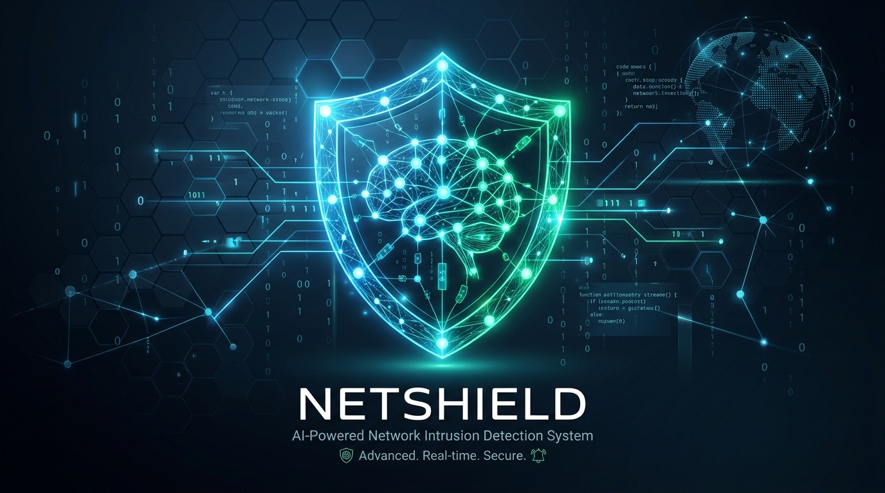
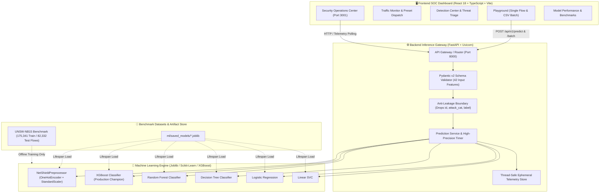
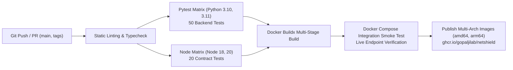

<p align="center">
  
</p>

<div align="center">

# 🛡️ NetShield: AI-Powered Network Intrusion Detection System

### High-Throughput Defensive Security Telemetry & Real-Time Cyber Attack Classification

> *Zero-Leakage ML Pipeline + High-Throughput FastAPI Microservice + Modern React SOC Dashboard*

<p align="center">
  
  
  
  
  
  
  
  
  
  
  
  
</p>

<p align="center">
  
  
  
</p>

</div>

<p align="center">
  A production-grade, machine learning-powered <strong>Network Intrusion Detection System (NIDS)</strong> engineered to classify high-velocity network flow telemetry into <strong>Benign (Normal)</strong> or <strong>Malicious (Attack)</strong> traffic in real time.<br />
  Combines an audited <strong>zero-leakage ML pipeline</strong> with an asynchronous <strong>FastAPI inference gateway</strong> and a modern <strong>Security Operations Center (SOC) dashboard</strong>.
</p>

> [!WARNING]
> **Defensive Security & Academic Disclaimer** — This system is engineered strictly for **defensive network security monitoring, educational exploration, and academic research** under Course Code `BCS586`. It does **not** contain offensive exploitation scripts or attack automation tools and must only be operated on network telemetry you are authorized to monitor.

---

## 📑 Table of Contents

- [💡 Why NetShield?](#-why-netshield)
- [✨ Key Features](#-key-features)
- [🏗 Architecture](#-architecture)
- [🛠 Tech Stack](#-tech-stack)
- [🚀 Getting Started](#-getting-started)
  - [Prerequisites](#prerequisites)
  - [🐳 Fast Setup with Docker (Recommended)](#-fast-setup-with-docker-recommended)
  - [⚙️ Manual Installation & Setup](#️-manual-installation--setup)
- [📁 Project Structure](#-project-structure)
- [📡 API Reference](#-api-reference)
- [🧠 ML Pipeline & Benchmark Audit](#-ml-pipeline--benchmark-audit)
  - [Audited Model Comparison](#audited-model-comparison-matrix)
  - [XGBoost Selection Defense](#why-xgboost-was-chosen-as-production-champion)
  - [Anti-Leakage Protocol](#anti-leakage-protocol)
  - [The 42 Evaluated Features](#the-42-evaluated-features)
- [🔬 Single-Flow & Batch Prediction (CLI)](#-single-flow--batch-prediction-cli)
- [🧪 Testing & Verification](#-testing--verification)
- [🔄 CI/CD Pipeline & DevOps Automation](#-cicd-pipeline--devops-automation)
- [🔑 Environment Variables](#-environment-variables)
- [❓ Troubleshooting](#-troubleshooting)
- [🗺 Roadmap](#-roadmap)
- [🤝 Contributing](#-contributing)
- [👥 Project Team & Academic Credits](#-project-team--academic-credits)
- [👤 Author](#-author)
- [📚 References & Bibliography](#-references--bibliography)
- [⚖️ License & Ethical Disclaimer](#-license--ethical-disclaimer)

---

## 💡 Why NetShield?

Modern enterprise networks ingest gigabits of telemetry every second. Traditional signature-based detection systems struggle against zero-day variants, while naive machine learning NIDS implementations often suffer from training leakage, high false positive rates, and high inference latency:

| Traditional / Naive NIDS Challenge | The NetShield Approach |
|---|---|
| **Synthetic Accuracy Spikes** caused by ground-truth leakage (`id`, `attack_cat`) | **Strict Anti-Leakage Boundary** rejecting ground-truth labels and fitting transformers exclusively on training partitions |
| **Alert Fatigue** from noisy classifiers triggering endless false positives | **Production Champion XGBoost** audited at **2.10% False Positive Rate** with calibrated probability scores |
| **Inference Bottlenecks** that stall packet ingestion queues | **Sub-millisecond inference** (**0.394 ms / 1,000 flows**) powered by vectorized scikit-learn & XGBoost C++ backends |
| **Opaque Black Boxes** lacking actionable triage context | **SOC Telemetry Dashboard** with threat severity categorization, packet inspection modals, and live telemetry charts |
| **Deployment Fragility** requiring complicated manual dependency setups | **Zero-Config Docker Compose** orchestration with automated GitHub Actions CI/CD matrix testing |

---

## ✨ Key Features

### 🛡️ Real-Time Flow Classification
- Ingests **42-dimensional NetFlow / IPFIX telemetry tuples** (duration, protocols, TTL, jitter, window sizes, byte rates).
- Sub-millisecond binary classification: **Normal (0)** vs. **Attack (1)**.
- Calibrated probability confidence scores for fine-grained threat grading.

### 🎛️ Comprehensive SOC Dashboard Views

<table>
<tr>
<td width="50%">

**📊 Security Operations Center (`/`)**
- Live telemetry KPI cards (Total flows, Benign rate, Attack alerts, Active model).
- Real-time ingestion response-time timeline chart.
- Traffic distribution ratio donut chart with live percentages.
- Empty states with one-click test telemetry dispatchers.

</td>
<td width="50%">

**🚨 Threat Detection Center (`/detections`)**
- Isolated malicious flow triage table.
- Threat severity classification: `CRITICAL` / `HIGH` / `ELEVATED` / `LOW`.
- Deep-dive packet modal displaying the entire 42-feature telemetry tuple.
- Filter by model confidence, timestamp, or protocol.

</td>
</tr>
<tr>
<td width="50%">

**📡 Traffic Monitor & Preset Deck (`/traffic`)**
- Live flow stream table with filter tabs (*All*, *Normal*, *Attacks*).
- Instant preset dispatch for verified UNSW-NB15 attack vectors:
  - Backdoors, DoS, Exploits, Normal HTTP, and Reconnaissance.

</td>
<td width="50%">

**🧪 Prediction Playground (`/playground`)**
- **Interactive Form:** 42-feature manual entry across 4 organized tabs with real-time validation and preset loaders.
- **Batch CSV Upload:** Client-side CSV ingestion with PapaParse, automatic leakage column stripping, progress tracking, and annotated CSV export.

</td>
</tr>
</table>

### ⚡ Enterprise SaaS Usability
- **Command Palette (`⌘K` / `Ctrl+K`):** Fast keyboard-driven page navigation, quick model switching, and action dispatch.
- **Keyboard Shortcuts Cheatsheet (`?`):** Quick-reference modal for hotkeys (`1`–`7` for pages, `R` to refresh, `ESC` to close).
- **First-Run Onboarding Tour:** Interactive 4-step modal introducing core dashboard telemetry to new SOC operators.
- **Zero-Flicker Layout:** Sub-pixel stable sidebar and navigation tabs with no layout jumps or box-shadow flash.

---

## 🏗 Architecture



---

## 🛠 Tech Stack

<table>
  <thead>
    <tr>
      <th>Layer</th>
      <th>Technology</th>
      <th>Purpose</th>
    </tr>
  </thead>
  <tbody>
    <tr>
      <td rowspan="6"><strong>Frontend</strong></td>
      <td>React 18 + TypeScript 5.7+</td>
      <td>Modern reactive UI with strict static type safety</td>
    </tr>
    <tr>
      <td>Vite 6.1+</td>
      <td>Ultra-fast development server & optimized production bundler</td>
    </tr>
    <tr>
      <td>Tailwind CSS 3.4+</td>
      <td>Cybersecurity dark-theme design system with sub-pixel borders</td>
    </tr>
    <tr>
      <td>Lucide React</td>
      <td>Modern cybersecurity and telemetry iconography</td>
    </tr>
    <tr>
      <td>Recharts 2.15+</td>
      <td>Interactive area timelines, response latency charts & donut gauges</td>
    </tr>
    <tr>
      <td>PapaParse</td>
      <td>High-speed client-side CSV parsing with memory streaming</td>
    </tr>
    <tr>
      <td rowspan="5"><strong>Backend</strong></td>
      <td>FastAPI 0.110+</td>
      <td>Asynchronous, high-throughput REST API microservice</td>
    </tr>
    <tr>
      <td>Pydantic v2</td>
      <td>Strict schema validation, type casting & defensive payload checks</td>
    </tr>
    <tr>
      <td>Uvicorn</td>
      <td>Lightning-fast ASGI production web server</td>
    </tr>
    <tr>
      <td>NumPy & Pandas</td>
      <td>Vectorized telemetry manipulation & batch feature transformation</td>
    </tr>
    <tr>
      <td>Pytest</td>
      <td>Comprehensive automated test runner for routes & edge cases</td>
    </tr>
    <tr>
      <td rowspan="4"><strong>ML Pipeline</strong></td>
      <td>XGBoost 2.0+</td>
      <td>Gradient boosted trees — Production Champion (0.394 ms latency)</td>
    </tr>
    <tr>
      <td>Scikit-Learn 1.3+</td>
      <td>Random Forest, Decision Tree, Logistic Regression, Linear SVC</td>
    </tr>
    <tr>
      <td>Joblib</td>
      <td>High-speed serialization & deserialization of trained pipelines</td>
    </tr>
    <tr>
      <td>UNSW-NB15</td>
      <td>Modern cybersecurity benchmark dataset (257k+ total flows)</td>
    </tr>
    <tr>
      <td rowspan="4"><strong>DevOps</strong></td>
      <td>Docker 20+</td>
      <td>Multi-stage containerization with non-root security boundaries</td>
    </tr>
    <tr>
      <td>Docker Compose v2+</td>
      <td>Multi-container orchestration for backend and frontend services</td>
    </tr>
    <tr>
      <td>Nginx 1.27 Alpine</td>
      <td>High-performance reverse proxy, gzip compression & SPA routing</td>
    </tr>
    <tr>
      <td>GitHub Actions</td>
      <td>Automated CI/CD matrix testing (Python 3.10/3.11, Node 18/20)</td>
    </tr>
  </tbody>
</table>

---

## 🚀 Getting Started

### Prerequisites

| Tool | Version | Verification Command | Official Link |
|---|---|---|---|
| **Docker** | 20.10+ | `docker --version` | [docker.com](https://www.docker.com) |
| **Docker Compose** | v2.0+ | `docker compose version` | [docs.docker.com/compose](https://docs.docker.com/compose/) |
| **Python** | 3.10+ | `python3 --version` | [python.org](https://python.org) |
| **Node.js** | 18+ LTS | `node -v` | [nodejs.org](https://nodejs.org) |
| **Git** | 2.0+ | `git --version` | [git-scm.com](https://git-scm.com) |

---

## 🐳 Fast Setup with Docker (Recommended)

If you have Docker and Docker Compose installed, you can launch the complete NetShield stack with a single command without installing Python, Node.js, or virtual environments locally.

### 1. Launching the Stack
Clone the repository and run:

```bash
git clone https://github.com/gopaljilab/NetShield-.git
cd NetShield-
docker compose up --build -d
```

This single command will:
* Build the multi-stage Python 3.11 backend container running under a secure non-root `netshield` user.
* Pre-load all 5 pre-trained machine learning model artifacts into memory.
* Build the React frontend distribution and serve it through high-performance Nginx 1.27 Alpine.
* Configure reverse proxying for `/api/` traffic from port `3001` to port `8000`.

### 2. Access the Live Services
Once started, open your browser:
* **Frontend SOC Dashboard:** [http://localhost:3001](http://localhost:3001)
* **Interactive OpenAPI Docs (Swagger UI):** [http://localhost:8000/docs](http://localhost:8000/docs)
* **Backend Health Check:** [http://localhost:8000/api/v1/health](http://localhost:8000/api/v1/health)

### 3. Containerized Local Development (with Hot-Reload)
To develop locally with live file sync and hot-reloading active inside containers:
```bash
docker compose -f docker-compose.dev.yml up
```

### 4. Stopping the Stack
To shut down containers while preserving workspace state:
```bash
docker compose down
```

---

## ⚙️ Manual Installation & Setup

If you prefer to run services natively on your host machine:

### 1. 📥 Clone the Repository

```bash
git clone https://github.com/gopaljilab/NetShield-.git
cd NetShield-
```

### 2. 🐍 Backend Setup & Launch

<details>
<summary><strong>🐧 Linux / 🍎 macOS</strong></summary>

```bash
# 1. Create a Python virtual environment
python3 -m venv venv

# 2. Activate virtual environment
source venv/bin/activate

# 3. Upgrade pip and install dependencies
pip install --upgrade pip
pip install -r backend/requirements.txt

# 4. Start the FastAPI ASGI server
python3 -m uvicorn backend.app.main:app --host 0.0.0.0 --port 8000 --reload
```

</details>

<details>
<summary><strong>🪟 Windows (PowerShell)</strong></summary>

```powershell
# 1. Create a Python virtual environment
python -m venv venv

# 2. Activate virtual environment
.\venv\Scripts\Activate.ps1

# 3. Upgrade pip and install dependencies
python -m pip install --upgrade pip
pip install -r backend\requirements.txt

# 4. Start the FastAPI ASGI server
python -m uvicorn backend.app.main:app --host 0.0.0.0 --port 8000 --reload
```

</details>

### 3. ⚛️ Frontend Setup & Launch

Open a separate terminal window:

```bash
cd frontend
npm install
npm run dev
```

### 4. 🌐 Service Endpoints Summary

| Service | Host URL | Description |
|---|---|---|
| **Frontend SOC Dashboard** | [http://localhost:3001](http://localhost:3001) | Security Operations Center React UI |
| **Backend API Gateway** | [http://localhost:8000](http://localhost:8000) | FastAPI ASGI microservice |
| **Swagger UI Documentation** | [http://localhost:8000/docs](http://localhost:8000/docs) | Interactive REST API tester |
| **ReDoc Documentation** | [http://localhost:8000/redoc](http://localhost:8000/redoc) | Alternative API documentation |

---

## 📁 Project Structure

```
NetSheild/
├── dataset/                           # Benchmark datasets
│   ├── UNSW_NB15_training-set.csv     # Official UNSW-NB15 training partition (175,341 rows)
│   ├── UNSW_NB15_testing-set.csv      # Official UNSW-NB15 testing partition (82,332 rows)
│   └── NUSW-NB15_features.csv         # Feature dictionary & data type mappings
├── ml/                                # Machine learning pipeline
│   ├── preprocessing.py               # Leak-free NetShieldPreprocessor transformer
│   ├── train.py                       # Training script for 5 candidate models
│   ├── evaluate.py                    # Evaluation & audit metrics generator
│   └── saved_models/                  # Serialized Joblib artifacts
│       ├── preprocessor.joblib        # Fitted OneHotEncoder + StandardScaler
│       ├── xgboost.joblib             # Production champion model (0.394 ms latency)
│       ├── random_forest.joblib       # Random forest classifier
│       ├── decision_tree.joblib       # Decision tree classifier
│       ├── logistic_regression.joblib # Logistic regression classifier
│       └── linear_svc.joblib          # Linear SVC classifier
├── backend/                           # FastAPI REST microservice
│   ├── app/
│   │   ├── main.py                    # App entrypoint, lifespan loader, CORS middleware
│   │   ├── config.py                  # Environment-aware settings
│   │   ├── schemas/                   # Pydantic v2 validation models
│   │   │   ├── prediction.py          # 42-feature input, single & batch response schemas
│   │   │   ├── health.py              # Health check response schema
│   │   │   ├── models.py              # Model discovery schemas
│   │   │   └── statistics.py          # Telemetry counters schema
│   │   ├── services/                  # Business logic
│   │   │   ├── model_service.py       # Artifact discovery & metadata lookup
│   │   │   └── prediction_service.py  # Inference orchestration & thread-safe metrics
│   │   └── api/routes/                # Route handlers (/predict, /health, /models, /statistics)
│   ├── tests/                         # Pytest test suite (50 tests total)
│   │   ├── test_edge_cases.py         # DDoS invariants, traversal, fuzzing & sanitization
│   │   ├── test_health.py             # Healthcheck probes
│   │   ├── test_models.py             # Model discovery & metadata
│   │   ├── test_predict.py            # Single flow predictions
│   │   ├── test_batch_predict.py      # High-throughput batch inference
│   │   ├── test_statistics.py         # Telemetry counters
│   │   └── test_validation.py         # Anti-leakage boundary enforcement
│   ├── Dockerfile                     # Multi-stage Python 3.11 container
│   └── requirements.txt               # Backend Python dependencies
├── frontend/                          # React + TypeScript + Vite dashboard
│   ├── src/
│   │   ├── pages/                     # 7 core views (Overview, Traffic, Detections, etc.)
│   │   ├── components/                # Layout, Charts, Playground, and Common UI
│   │   ├── context/AppContext.tsx     # Global state management & telemetry polling
│   │   ├── api/client.ts              # Type-safe Fetch API client
│   │   ├── types/                     # TypeScript interfaces for flows, models, and telemetry
│   │   └── tests/test_frontend.mjs    # Frontend contract & bundle test runner (20 tests)
│   ├── package.json                   # Frontend npm configuration & scripts
│   ├── tailwind.config.js             # Cybersecurity dark-theme color palette
│   ├── nginx.conf                     # Production Nginx reverse proxy configuration
│   ├── Dockerfile                     # Multi-stage Node 20 builder + Nginx runner
│   └── vite.config.ts                 # Dual-stack IPv6/IPv4 dev server configuration
├── .github/
│   └── workflows/ci.yml               # GitHub Actions CI/CD matrix pipeline
├── docker-compose.yml                 # Production multi-container composition
├── docker-compose.dev.yml             # Local containerized development with hot-reload
├── research/                          # Academic documentation & audit reports
│   ├── 01_PROJECT_FILE_INVENTORY.md   # Discovery audit across all workspace files
│   ├── 05_UNSW_NB15_DATASET_ANALYSIS.md # Feature distribution & protocol analysis
│   ├── 10_REFERENCES.md               # IEEE formatted bibliography
│   └── reports/                       # CSV audit metrics & phase benchmark reports
├── tests/                             # Root pipeline integration tests
│   ├── test_preprocessing.py          # Transformer serialization & anti-leakage checks
│   └── test_pipeline.py               # End-to-end model inference checks
└── README.md                          # Master project documentation (this file)
```

---

## 📡 API Reference

All backend endpoints are prefixed with `/api/v1`. Interactive documentation and schema testing are available at `/docs`.

| Method | Endpoint | Description | Sample Response / Status |
| :--- | :--- | :--- | :--- |
| `GET` | `/api/v1/health` | Service health, uptime, loaded models & artifact status | `{"status": "healthy", "version": "1.0.0"}` |
| `GET` | `/api/v1/models` | Whitelisted models, metadata, audited accuracy & default model | Model catalog with Phase 2 audit metrics |
| `POST` | `/api/v1/predict` | Single network flow classification with fine-grained latency breakdown | `{"prediction": 1, "label": "Attack", "probability": 0.98}` |
| `POST` | `/api/v1/predict/batch` | High-throughput vectorized batch classification (up to 5,000 flows) | Itemized array of predictions + batch metrics |
| `GET` | `/api/v1/statistics` | Ephemeral telemetry counters (total flows, normal vs attack counts) | Ingested flow counters & model usage breakdown |
| `GET` | `/docs` | Interactive Swagger UI / OpenAPI documentation | Interactive API tester |

### Sample Single Flow Request (`POST /api/v1/predict?model_name=xgboost`)

```bash
curl -X POST "http://localhost:8000/api/v1/predict?model_name=xgboost" \
  -H "Content-Type: application/json" \
  -d '{
    "dur": 0.000011,
    "proto": "udp",
    "service": "-",
    "state": "INT",
    "spkts": 2,
    "dpkts": 0,
    "sbytes": 496,
    "dbytes": 0,
    "rate": 90909.0902,
    "sttl": 254,
    "dttl": 0,
    "sload": 180363632.0,
    "dload": 0.0,
    "sloss": 0,
    "dloss": 0,
    "sinpkt": 0.011,
    "dinpkt": 0.0,
    "sjit": 0.0,
    "djit": 0.0,
    "swin": 0,
    "stcpb": 0,
    "dtcpb": 0,
    "dwin": 0,
    "tcprtt": 0.0,
    "synack": 0.0,
    "ackdat": 0.0,
    "smean": 248,
    "dmean": 0,
    "trans_depth": 0,
    "response_body_len": 0,
    "ct_srv_src": 2,
    "ct_state_ttl": 2,
    "ct_dst_ltm": 1,
    "ct_src_dport_ltm": 1,
    "ct_dst_sport_ltm": 1,
    "ct_dst_src_ltm": 2,
    "is_ftp_login": 0,
    "ct_ftp_cmd": 0,
    "ct_flw_http_mthd": 0,
    "ct_src_ltm": 1,
    "ct_srv_dst": 2,
    "is_sm_ips_ports": 0
  }'
```

### Sample Response (`200 OK`)

```json
{
  "prediction": 1,
  "label": "Attack",
  "probability": 0.9863,
  "model_used": "xgboost",
  "latency_ms": 0.394,
  "inference_timestamp": "2026-11-11T19:30:00Z"
}
```

---

## 🧠 ML Pipeline & Benchmark Audit

NetShield trains and rigorously audits 5 distinct machine learning algorithms on the official **UNSW-NB15** partitioned test set (**82,332 unseen test flows**). Evaluation was executed under zero-leakage constraints.

### Audited Model Comparison Matrix

| Model | Accuracy (%) | Precision (%) | Recall (%) | F1-Score (%) | FPR (%) | FNR (%) | ROC-AUC (%) | Latency (ms / 1k flows) | Role / Status |
| :--- | :---: | :---: | :---: | :---: | :---: | :---: | :---: | :---: | :--- |
| **XGBoost** | **90.00%** | **98.87%** | **86.29%** | **92.15%** | **2.10%** | **13.71%** | **98.63%** | **0.394 ms** | **Production Champion (Default)** |
| **Random Forest** | 90.21% | 98.80% | 86.67% | 92.34% | 2.25% | 13.33% | 98.69% | 3.560 ms | Bagging Ensemble Alternative |
| **Decision Tree** | 89.17% | 98.73% | 85.19% | 91.46% | 2.34% | 14.81% | 96.95% | 0.080 ms | Ultra-Low Latency Baseline |
| **Logistic Regression** | 87.77% | 97.83% | 83.89% | 90.32% | 3.97% | 16.11% | 97.79% | 0.507 ms | Linear Baseline |
| **Linear SVC** | 87.51% | 97.79% | 83.54% | 90.10% | 4.03% | 16.46% | 97.76% | 0.510 ms | Geometric Margin Baseline |

### Why XGBoost was chosen as Production Champion:
1. **Sub-Millisecond Latency:** XGBoost evaluates 1,000 flows in **0.394 ms** (~9x faster than Random Forest's 3.56 ms), crucial for preventing buffer bloat under heavy network traffic.
2. **Lowest False Positive Rate (FPR):** At **2.10% FPR**, it produces the lowest rate of false alarms, protecting SOC analysts from alert fatigue.
3. **Calibrated Probabilities:** Yields reliable, smooth probability curves for multi-tier severity categorization (`CRITICAL`, `HIGH`, `ELEVATED`, `LOW`).

### Anti-Leakage Protocol

To guarantee reliable generalization in real-world deployment, NetShield enforces architectural anti-leakage boundaries:

1. **Exclusion of Metadata & Ground Truth:**
   - `id`: Database surrogate key (prevents index memorization).
   - `attack_cat`: Ground-truth multiclass target category.
   - `label`: Ground-truth binary target label (`0 = Normal`, `1 = Attack`).
   - *Any incoming prediction payload attempting to supply these keys is immediately rejected by the Pydantic schema validator with an HTTP 422 error.*
2. **Strict Transformer Fitting:**
   - Preprocessing transformers (`OneHotEncoder` and `StandardScaler`) are fit **strictly** on the training partition (`UNSW_NB15_training-set.csv`).
   - Unknown categorical values at runtime use `handle_unknown='ignore'` to digest zero-day protocols and unexpected TCP states without exceptions.

### The 42 Evaluated Features

| Category | Count | Feature Names |
| :--- | :---: | :--- |
| **Basic Flow Characteristics** | 13 | `dur`, `proto`, `service`, `state`, `spkts`, `dpkts`, `sbytes`, `dbytes`, `rate`, `sttl`, `dttl`, `sload`, `dload` |
| **TCP Dynamics & Timing** | 7 | `sloss`, `dloss`, `sinpkt`, `dinpkt`, `sjit`, `djit`, `swin`, `stcpb`, `dtcpb`, `dwin` |
| **Content & Payload Metrics** | 8 | `tcprtt`, `synack`, `ackdat`, `smean`, `dmean`, `trans_depth`, `response_body_len`, `ct_srv_src` |
| **Connection Counts & Windowing** | 14 | `ct_state_ttl`, `ct_dst_ltm`, `ct_src_dport_ltm`, `ct_dst_sport_ltm`, `ct_dst_src_ltm`, `ct_src_ltm`, `ct_srv_dst`, `is_sm_ips_ports`, `ct_ftp_cmd`, `ct_flw_http_mthd`, `ct_src_ltm`, `is_ftp_login` |

---

## 🔬 Single-Flow & Batch Prediction (CLI)

You can run predictions directly from the command line using the Python test client:

```bash
# Predict using a JSON payload file
python3 -c "
import requests, json
payload = json.load(open('sample_flow.json'))
resp = requests.post('http://localhost:8000/api/v1/predict?model_name=xgboost', json=payload)
print(resp.json())
"
```

---

## 🧪 Testing & Verification

NetShield includes automated test suites across backend and frontend layers (**70 total tests**, 100% passing):

### Run All Backend Tests (Pytest — 50 Tests)
```bash
python3 -m pytest backend/tests/ tests/ -v
```
*Tests verify:*
- **Defensive Edge Cases (`test_edge_cases.py`):**
  - Unseen zero-day protocols and corrupted TCP states without service disruption.
  - Volumetric DDoS floods with extreme byte/packet metrics (`1e12` bytes, `1e9` rate) without numerical overflow or NaN.
  - Zero-value flows preventing division-by-zero errors.
  - Nanosecond floating-point precision metrics.
  - Path traversal injection (`../../../../etc/shadow`) with automated error sanitization.
  - SQL injection and XSS categorical payload isolation.
  - Vectorized batch invariants across all 5 candidate models.
- **Health & Discovery (`test_health.py`, `test_models.py`):** Model catalog discovery and healthcheck probes.
- **Prediction Invariants (`test_predict.py`, `test_batch_predict.py`):** Single and batch prediction consistency.
- **Anti-Leakage Enforcement (`test_validation.py`):** Strict 422 rejection of `id`, `attack_cat`, `label`, and negative metrics.
- **Pipeline Serialization (`test_preprocessing.py`, `test_pipeline.py`):** Joblib round-tripping and dimensionality checks.

### Run Frontend Contract & Edge Case Tests (Node.js — 20 Tests)
```bash
npm --prefix frontend test
```
*Tests verify:*
- Production build bundle compilation and asset generation.
- Full 42-feature schema completeness in form and sample payloads.
- Client-side anti-leakage exclusion of `id`, `attack_cat`, and `label`.
- API client contract alignment with FastAPI routes.
- Model benchmark consistency against `research/reports/model_comparison.csv`.
- **Client-Side CSV Parsing Edge Cases:** Automatic stripping of ground-truth leakage columns (`attack_cat`, `label`).
- **Real-Time Form Validation Boundaries:** Boundary enforcement (`num < 0`, `is_ftp_login in {0, 1}`).
- **Threat Rate Indicator Scoring:** Safe zero-flow division guard (`0.0%`) and severity threshold transitions (`CRITICAL`, `ELEVATED`, `GUARDED`, `LOW`).
- **Detection Probability Gauge Tiers:** Severity categorization for threat triage.
- **Session History Storage Invariants:** Safe deserialization with corrupted JSON recovery and 100-item retention bounds.
- **Zero-Flicker Navigation Contract:** Stable 1px borders, `transition-colors`, and box-shadow expansion prevention.

### Build Frontend for Production
```bash
npm --prefix frontend run build
```

---

## 🔄 CI/CD Pipeline & DevOps Automation

NetShield features an automated CI/CD workflow defined in [`.github/workflows/ci.yml`](.github/workflows/ci.yml) that triggers on every `push` and `pull_request`:



### Pipeline Workflow Stages

1. **Backend Matrix Job (`backend-test`):** Tests across **Python 3.10** and **Python 3.11**, executes `flake8` linting, runs all 50 Pytest test cases with coverage (`--cov=backend/app`), and generates XML reports.
2. **Frontend Matrix Job (`frontend-test`):** Tests across **Node.js 18.x** and **Node.js 20.x**, executes `tsc --noEmit` type checking, runs all 20 frontend contract tests, and builds production bundles.
3. **Docker Integration Smoke Test (`docker-smoke-test`):** Builds backend and frontend containers with Buildx cache, spins up `docker compose`, probes `/api/v1/health` and `/healthz`, and executes live flow prediction payloads against containerized models.
4. **Publish to GitHub Container Registry (`publish-ghcr`):** Automatically triggered on releases to publish multi-architecture images (`linux/amd64`, `linux/arm64`) to GHCR.

---

## 🔑 Environment Variables

| Variable | File | Default | Description |
|---|---|---|---|
| `VITE_API_BASE_URL` | `frontend/.env` | `http://localhost:8000` | Backend API base URL for frontend requests |
| `NETSHIELD_ENV` | Environment | `production` | Backend environment (`development`, `production`) |
| `BACKEND_PORT` | `docker-compose.yml` | `8000` | FastAPI ASGI listening port |
| `FRONTEND_PORT` | `docker-compose.yml` | `3001` | React / Nginx listening port |

---

## ❓ Troubleshooting

<details>
<summary><strong>"Port 8000 or Port 3001 already in use"</strong></summary>

- Check which process is occupying the port:
  - **Linux / macOS:** `lsof -i :8000` or `lsof -i :3001`
  - **Windows:** `netstat -ano | findstr :8000`
- Terminate the conflicting process or change ports in `docker-compose.yml`.

</details>

<details>
<summary><strong>"Model artifacts not found on startup"</strong></summary>

- Verify that `ml/saved_models/` contains all 5 `.joblib` model files and `preprocessor.joblib`.
- If missing, re-run model training from the workspace root:
  ```bash
  python3 ml/train.py
  ```

</details>

<details>
<summary><strong>"Validation Error (HTTP 422) on prediction"</strong></summary>

- Confirm that your JSON flow payload does **not** contain `id`, `attack_cat`, or `label`.
- Ensure all 42 required numeric and categorical fields are provided with non-negative numbers.

</details>

<details>
<summary><strong>"Docker Buildx permission denied"</strong></summary>

- Ensure your user is part of the docker group: `sudo usermod -aG docker $USER`.
- Re-login to apply group changes.

</details>

---

## 🗺 Roadmap

- [x] 🚀 Sub-millisecond XGBoost champion model (0.394 ms / 1k flows)
- [x] 🛡️ Strict anti-leakage boundary enforcement
- [x] 📊 Interactive Security Operations Center (SOC) dashboard
- [x] 🧪 Batch CSV ingestion and export engine
- [x] 🐳 Multi-stage Docker containerization and Docker Compose orchestration
- [x] 🔄 Automated GitHub Actions CI/CD matrix pipeline
- [ ] 📡 Live PCAP / eBPF kernel packet capture module
- [ ] 🤖 SHAP / LIME explainability waterfall charts for individual flow triage
- [ ] 🌐 Distributed Kafka telemetry stream ingestion

---

## 🤝 Contributing

We welcome contributions from the cybersecurity and machine learning community!

1. Fork the repository: `https://github.com/gopaljilab/NetShield-`
2. Create your feature branch (`git checkout -b feat/advanced-detection`)
3. Commit your changes (`git commit -m 'feat: add advanced detection capability'`)
4. Ensure all tests pass: `pytest backend/tests/ tests/` and `npm --prefix frontend test`
5. Push to the branch (`git push origin feat/advanced-detection`)
6. Open a Pull Request

---

## 👥 Project Team & Academic Credits

- **Course:** B.Tech Minor Project (Course Code: `BCS586`, Semester VI)
- **Department:** Department of Computer Science & Engineering
- **Project Supervisor & Guide:** Dr. Jerline Sheeba Anni, Head of Department, Dept. of CSE
- **Student Development Team:**
  - **Tejashwini PB** (`1BH24CS077`)
  - **Ruthu K** (`1BH24CS057`)
  - **Lalit** (`1BH25CS408`)
  - **Gopal Gupta** (`1BH25CS406`)

---

## 👤 Author

[](https://github.com/gopaljilab)

**Gopal Gupta**
*Computer Science Engineer · Full-Stack Developer · Machine Learning & Cybersecurity Enthusiast*

---

## 📚 References & Bibliography

1. **[Foundational Dataset]** N. Moustafa and J. Slay, *"UNSW-NB15: a comprehensive data set for network intrusion detection systems (UNSW-NB15 network data set),"* in **Proceedings of the 2015 Military Communications and Information Systems Conference (MilCIS)**, Canberra, ACT, Australia, 2015, pp. 1–6. DOI: [10.1109/MilCIS.2015.7348942](https://doi.org/10.1109/MilCIS.2015.7348942).
2. **[Hybrid Architectures]** R. Fu, *"Design and Implementation of Network Intrusion Detection System based on Machine Learning,"* in **Proceedings of the 2025 International Conference on Intelligent Systems and Computational Networks (ICISCN)**, IEEE, 2025, pp. 1–6. DOI: [10.1109/ICISCN64258.2025.10934502](https://doi.org/10.1109/ICISCN64258.2025.10934502).
3. **[Comparative Study]** G. Abdiyeva-Aliyeva, N. Allakhverdiyeva, I. Balazade, and N. Alili, *"Evaluating Machine Learning Algorithms for Enhancing Network Intrusion Detection Systems: A Comparative Study,"* in **IEEE Conference on Computer Science and Information Technology**, IEEE, 2025, pp. 1–4. ISBN: 979-8-3315-0993-4.
4. **[Explainable AI in NIDS]** K. Dietz, J. Schleicher, S. Geißler, M. Seufert, and T. Hoßfeld, *"Irreconcilable Differences? Investigating Consensus of Post-hoc XAI for ML-NIDS via Decomposition,"* in **Proceedings of the 2025 21st International Conference on Network and Service Management (CNSM)**, IEEE, 2025, pp. 1–9.
5. **[Benchmark Foundations]** I. Sharafaldin, A. H. Lashkari, and A. A. Ghorbani, *"Toward Generating a New Intrusion Detection Dataset and Intrusion Traffic Characterization,"* in **Proceedings of the 4th International Conference on Information Systems Security and Privacy (ICISSP)**, 2018, pp. 108–116. DOI: [10.5220/0006639801080116](https://doi.org/10.5220/0006639801080116).

---

## ⚖️ License & Ethical Disclaimer

- **License:** Distributed under the MIT License.
- **Defensive & Research Intent:** NetShield is developed solely for defensive cybersecurity monitoring, educational exploration, and academic evaluation under Course Code `BCS586`. It does not contain exploit tools, offensive payloads, or automated attack automation.
- **Operational Scope:** Telemetry processed by NetShield represents extracted flow-level network statistics (as defined by NetFlow / IPFIX and UNSW-NB15). Machine learning classifications are probabilistic algorithmic assessments designed to assist Security Operations Center (SOC) personnel, not to substitute for human security analysis.

---

<div align="center">

*Built with ❤️ for resilient cybersecurity defense*

⭐ **Star this repository** if you find it helpful!

</div>
